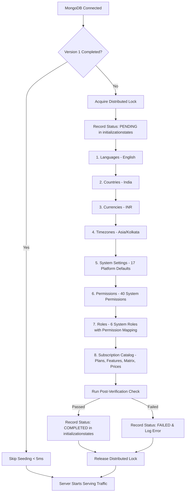

# Sticky Ji Database Initialization & Seeding Architecture

## 1. Overview & Objectives

Sticky Ji features an automated, production-ready, idempotent database initialization system. When deploying the backend to a fresh server and an empty MongoDB database, the application automatically provisions all essential system-level data required for platform operation.

### Key Guarantees
- **Automated First-Time Initialization**: Fresh databases are automatically populated on server startup without requiring manual MongoDB Compass interventions.
- **Strict Idempotency**: Subsequent backend restarts detect completed initialization in `< 5ms` and execute zero redundant writes.
- **Distributed Concurrency Safe**: A distributed MongoDB lock (`initializationlocks`) guarantees that when multiple backend instances start simultaneously, exactly one runner performs initialization while others wait safely.
- **Existing Customer Data Protection**: Production customer records (users, workspaces, notes, subscriptions, payments, custom roles, user preferences) are never dropped, modified, or overwritten.
- **Separation of Concerns**: Initial essential seeding is distinct from ongoing commercial subscription catalog updates. Existing subscriber pricing is strictly immutable.

---

## 2. System Architecture & Dependency Order

The initialization pipeline is orchestrated by `DatabaseInitializer` (`src/database/initialization/database-initializer.ts`). It executes seed steps strictly in topological dependency order:



### Dependency Execution Rationale
1. **Languages**: Independent baseline localization (`LanguageModel`).
2. **Countries**: Independent geographical data (`CountryModel`).
3. **Currencies**: Independent monetary unit (`CurrencyModel` - INR).
4. **Timezones**: References country code `IN` (`TimezoneModel`).
5. **System Settings**: Platform-wide parameters (`SystemSettingModel` - 17 baseline keys).
6. **Permissions**: System authorization definitions (`PermissionModel` - 40 unique codes).
7. **Roles**: Depends on `PermissionModel` ObjectIds to bind permissions to roles (`RoleModel`).
8. **Subscription Catalog**: Depends on `CurrencyModel` (INR ObjectId) to bind `PlanPrice` models (`PlanModel`, `FeatureModel`, `PlanFeatureModel`, `PlanPriceModel`).

---

## 3. Database Collections Matrix

### System-Seeded Collections (Managed Data)

| Collection | Schema Model | Identification Key | Seed Rule | Overwrite Policy |
|---|---|---|---|---|
| `languages` | `LanguageModel` | `code: "en"` | Upsert default language | Non-destructive update |
| `countries` | `CountryModel` | `code: "IN"` | Upsert default country | Non-destructive update |
| `currencies` | `CurrencyModel` | `code: "INR"` | Upsert default currency | Preserves custom rates |
| `timezones` | `TimezoneModel` | `code: "Asia/Kolkata"` | Upsert default timezone | Non-destructive update |
| `systemsettings` | `SystemSettingModel` | `key: uppercase` | Upsert settings (`value` in `$setOnInsert`) | **Never overwrites** admin-configured `value` |
| `permissions` | `PermissionModel` | `code: uppercase` | Upsert system permissions | Preserves custom permissions |
| `roles` | `RoleModel` | `code: uppercase, isSystem: true` | Upsert system roles | **Never touches** custom roles (`isSystem: false`) |
| `plans` | `PlanModel` | `code: "FREE" \| "INDIVIDUAL" \| "PRO"` | Seeded via `SubscriptionSeedService` | Non-destructive, preserves custom plans |
| `features` | `FeatureModel` | `code: uppercase` | 21 features (15 boolean, 6 quotas) | Preserves disabled status |
| `planfeatures` | `PlanFeatureModel` | `planId + featureId` | Matrix of capabilities & quotas | Preserves custom associations |
| `planprices` | `PlanPriceModel` | `planId + currencyId + billingInterval` | 4 paid prices in INR paise | **Strictly immutable** |
| `initializationstates` | `InitializationStateModel` | `version: number` | Tracks initialization milestones | State log |
| `initializationlocks` | `InitializationLockModel` | `_id: "database_initialization"` | Distributed lock coordination | Ephemeral TTL lock |

### User-Generated Collections (Protected - Never Pre-Populated)

The following collections contain dynamic customer/tenant data and are **never** populated by system seeders:
- `users`: Registered users (no fake admin accounts or passwords).
- `userprofiles`: User profile metadata.
- `userpreferences`: User-specific UI and workspace preferences (generated per-user upon signup).
- `workspaces`: Customer workspaces.
- `workspacefolders`: Folders created inside workspaces.
- `workspacemembers`: Workspace memberships.
- `workspacememberinvitations`: Pending invitations.
- `stickynotes`: User sticky notes.
- `stickynotecolumns`: Board columns.
- `stickynotechecklists`, `stickynotechecklistitems`: Checklists.
- `stickynotelabels`, `stickynotefavorites`, `stickynoteassignees`: Note metadata.
- `counters`: Sequential note numbering per workspace.
- `usersubscriptions`: Active subscriber records (Free plan assigned dynamically on signup).
- `subscriptionpayments`: Payment records from Razorpay.
- `subscriptionreservations`: Entitlement reservations.
- `subscriptionusages`: Metered quota counters.
- `billingevents`: Webhook audit logs.
- `billingplanmappings`: Provider mappings.
- `checkoutintents`: In-flight checkouts.
- `sessions`: User auth tokens.
- `media`: User uploaded attachments.
- `auditlogs`: Platform audit trails.

---

## 4. Concurrency & Distributed Lock Architecture

To ensure high availability in containerized (Docker/Kubernetes/PM2) or multi-instance deployments:

1. **Atomic Lock Acquisition**:
   The runner performs an atomic `findOneAndUpdate` on `initializationlocks` where `locked == false` OR `expiresAt < now`.
2. **Crash Resilience (TTL)**:
   The lock has a default TTL of 60 seconds. If a runner crashes or loses connectivity, the lock expires automatically, preventing permanent deadlocks.
3. **Heartbeat**:
   While a runner is actively performing initialization, a background timer periodically extends `expiresAt` every 20 seconds. The timer is released immediately upon completion or failure.
4. **Coordinated Waiting**:
   Secondary instances that do not obtain the lock enter a non-blocking wait loop, polling every 1 second until `initializationstates` marks the version `COMPLETED`. Once complete, the waiting instances proceed to start HTTP listeners without performing redundant writes.

---

## 5. Working CLI Commands

Sticky Ji provides dedicated package.json scripts for database operations:

### 1. Automatic Startup (Standard)
```bash
npm run dev
# or in production:
npm start
```
*Connects to MongoDB, runs `initializeDatabaseIfRequired()`, skips if already completed, and launches Express.*

### 2. Explicit Database Initialization
```bash
# Initialize using default .env
npm run db:init

# Force re-execution of initialization even if marked completed
npm run db:init -- --force

# Use specific environment configuration
npm run db:init -- --env-file .env.production
```

### 3. Verify Database Initialization Status
```bash
# Check if all required records, collections, and indexes exist
npm run db:init:verify

# Verify a specific staging/production database
npm run db:init:verify -- --env-file .env.staging
```
*Exits with code `0` if all records match specification; exits with code `1` and outputs discrepancy report if records are missing.*

### 4. Subscription Catalog Management (Commercial Updates)
```bash
# Dry run subscription catalog plan (does not write to database)
npm run seed:subscriptions:dry-run

# Verify active subscription catalog against configured policies
npm run seed:subscriptions:verify

# Apply subscription catalog updates
npm run seed:subscriptions:apply
```

### 5. Automated Tests
```bash
# Run the 13-scenario database initialization test suite
npm run test:db-init

# Run the 25-scenario subscription seed test suite
npm run test:subscription-seed
```

---

## 6. Operational Procedures & Runbooks

### Initializing a Fresh Local Database
1. Ensure MongoDB is running locally (`mongodb://127.0.0.1:27017`).
2. Set `MONGO_URI=mongodb://127.0.0.1:27017/stickyji_dev` in `.env`.
3. Start the backend: `npm run dev`.
4. The system will log:
   ```text
   [DatabaseInitializer] Starting database initialization (version: 1)...
   [DatabaseInitializer] Database initialization completed successfully in 750ms.
   🚀 Server running at http://localhost:5000
   ```

### Initializing a Fresh Staging Database
1. Configure `MONGO_URI` in `.env.staging`.
2. Run explicit verification first:
   ```bash
   npm run db:init:verify -- --env-file .env.staging
   ```
   *(Expected: Exit code 1, reports NOT COMPLETED).*
3. Run initialization:
   ```bash
   npm run db:init -- --env-file .env.staging
   ```
4. Verify success:
   ```bash
   npm run db:init:verify -- --env-file .env.staging
   ```
   *(Expected: Exit code 0, PASSED).*

### Initializing a Fresh Production Database
1. Double-check the target `MONGO_URI` to prevent accidental modification of existing databases.
2. Ensure network security and replica set write concerns are configured.
3. Deploy the application service. On initial startup, the primary container will acquire the lock and initialize baseline data.
4. If preferred in your CI/CD pipeline, execute the initialization step prior to routing production traffic:
   ```bash
   npm run db:init -- --env-file /etc/stickyji/.env.production
   npm run db:init:verify -- --env-file /etc/stickyji/.env.production
   ```

### Recovery from a Failed Initialization
If an initialization fails due to a network blip or misconfiguration:
1. Check the database logs: `InitializationStateModel` records the error in the `error` field with status `FAILED`.
2. The distributed lock is released immediately on failure.
3. Rectify the underlying cause (e.g., MongoDB credentials or network timeout).
4. Run `npm run db:init` again. Because each seed step uses idempotent upserts (`findOneAndUpdate` / `bulkWrite`), partially inserted records are safely resolved without duplication.

### Introducing Future Seed Versions
When schema evolution requires new global system tables or migrations:
1. Increment `DatabaseInitializer.CURRENT_VERSION` to `2`.
2. Add the migration step to `SEED_REGISTRY`.
3. On next deployment, instances will detect version 2 as missing and apply the new milestone while preserving version 1 records.
